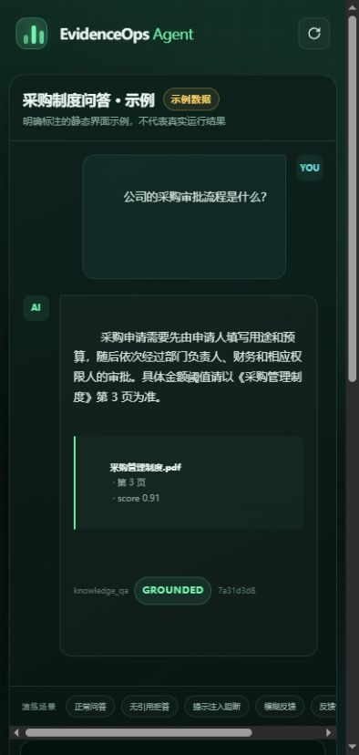
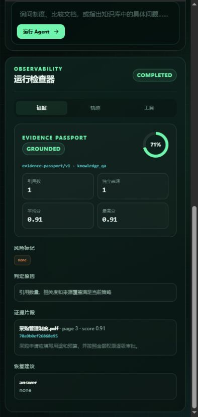

# EvidenceOps Agent：证据可信度驱动的企业知识 Agent

这不是一个只会“意图分类 + 调工具”的通用 Agent。项目把企业知识问答里最难落地的
问题——**模型回答了，但证据是否足够、是否被知识库里的恶意指令污染、失败后能否安全恢复**——
做成了显式的服务端控制面。

1. 显式 LangGraph 工作流；
2. 三类工具：知识检索、文档对比、知识库问题反馈草稿/提交；
3. 检索后置 `Evidence Guard`，为每次回答生成可解释的 `Evidence Passport`；
4. 无引用、低相关度、单来源对比、高风险弱证据时 fail-closed，不输出伪确定答案；
5. 隔离 RAG 文档中的疑似间接 Prompt Injection；
6. PostgreSQL LangGraph Checkpoint 与本地 Session/RAGFlow Session 隔离；
7. `interrupt()` 人工审批 + 数据库 compare-and-set，阻止并发重复审批；
8. 知识反馈定位门禁：必须说明具体知识点，模糊反馈先追问，不进入审批；
9. `Idempotency-Key` + 请求指纹 + 唯一约束，覆盖网络重放和同键异参冲突；
10. 稳定错误码、脱敏审计、生产配置 fail-fast、混沌评测；
11. `agent_runs`、`tool_calls` 全链路运行轨迹与 Docker Compose 部署；
12. 版本化三层评测：90 条黄金集、70 条对抗集、40 条脱敏回放种子集。
13. Execution Harness：步数、工具次数、总时限和估算 Token 四类运行预算；
14. 轻量 Span Trace：HTTP、LLM、工具、策略与终止事件写入 `run_events`；
15. 版本指纹：每个 run 固化 app、prompt、tool schema、policy、dataset 版本；
16. 上下文工程：有界历史摘要、重复消除、提示注入隔离和引用去重；
17. Tool Contract：deny-by-default、角色校验、风险等级、审批、超时和输出上限；
18. 模型路由：意图小模型/主模型/高风险强模型，失败后熔断并确定性降级。

详细设计、故障矩阵和面试讲法见 [UPGRADE_DESIGN.md](UPGRADE_DESIGN.md)。

## 界面预览

仓库内置一个零前端依赖的演示控制台，通过 Nginx 与 FastAPI 同源通信。它不是普通聊天壳，而是把
`Evidence Passport`、Harness Timeline、Tool Calls、引用来源和人工审批状态放在同一页面中。

<table>
  <tr>
    <td width="50%"></td>
    <td width="50%"></td>
  </tr>
  <tr>
    <td align="center">问答、引用与 Verdict</td>
    <td align="center">Evidence Passport 与恢复建议</td>
  </tr>
</table>

控制台提供六个预置场景：正常问答、无引用拒答、提示注入阻断、模糊反馈、反馈审批和双文档对比。
`/?sample=1` 只加载明确标注的静态界面示例，便于截图；正常页面始终调用真实后端 API。

## 0. 安全

原项目中的真实飞书密钥、RAGFlow Key 和数据库密码必须立即轮换。此项目不会携带原密钥。

## 1. 启动

```bash
cp .env.example .env
# 本地先保持 RAG_MOCK_MODE=true
# DATABASE_URL 与 POSTGRES_PASSWORD 中的密码必须保持一致
mkdir -p data
docker compose up --build
```

- 演示控制台：`http://localhost:3000`
- 静态界面示例：`http://localhost:3000/?sample=1`
- Swagger：`http://localhost:8000/docs`

前端通过 Nginx 将 `/api/*` 反向代理到 FastAPI，不接触 PostgreSQL、RAGFlow 或模型密钥。首次启动可直接
保持 `RAG_MOCK_MODE=true` 和 `DEV_AUTH_ENABLED=true`，因此不需要真实飞书、RAGFlow 或模型账号即可演示
Evidence Guard、审批工作流和 Harness。页面顶部会持续显示 `Demo Mode`，避免把 Mock 结果误认为生产结果。

开发认证请求头：

```text
X-Dev-User: demo-user
```

生产环境必须设置：

```env
APP_ENV=production
DEV_AUTH_ENABLED=false
RAG_MOCK_MODE=false
FEISHU_APP_ID=...
FEISHU_APP_SECRET=...
RAG_API_KEY=...
RAG_CHAT_ID=...
```

## 2. 调用顺序

### 创建本地会话

```bash
curl -X POST http://localhost:8000/api/v2/sessions \
  -H 'Content-Type: application/json' \
  -H 'X-Dev-User: demo-user' \
  -d '{"title":"制度咨询"}'
```

前端只保存响应中的本地 `id`，不再传入 `chat_id` 和真实 RAGFlow Session ID。

### 发起 Agent 运行

```bash
curl -X POST http://localhost:8000/api/v2/agent/runs \
  -H 'Content-Type: application/json' \
  -H 'X-Dev-User: demo-user' \
  -H 'Idempotency-Key: procurement-question-001' \
  -d '{
    "session_id":"替换为本地会话UUID",
    "query":"公司的采购审批流程是什么？"
  }'
```

回答中会额外返回 `evidence_passport`：

```json
{
  "verdict": "grounded",
  "confidence": 0.8613,
  "risk_flags": [],
  "coverage": {"citation_count": 1, "source_count": 1, "top_score": 0.99},
  "recommended_action": "answer",
  "recovery_plan": ["none"]
}
```

`verdict` 可能为 `grounded`、`review_required`、`insufficient`、`blocked`。后两种不会把候选答案透传给用户。

知识库问题反馈不是传统报修工单。反馈草稿包含 `knowledge_item`、`issue_type`、
`description`、`priority` 和 `target_status`。只有定位到具体制度、条款、流程节点或
食品安全知识点时，才会返回 `pending_approval`：

```bash
curl -X POST http://localhost:8000/api/v2/agent/runs/运行UUID/resume \
  -H 'Content-Type: application/json' \
  -H 'X-Dev-User: demo-user' \
  -d '{"approved":true,"comment":"确认提交"}'
```

如果用户只说“知识库有问题，请提交反馈”，系统会把工具状态标记为 `needs_input`，
返回补充定位提示，不进入审批，也不会写入 `knowledge_feedbacks`。

### 查看完整轨迹

```bash
curl http://localhost:8000/api/v2/agent/runs/运行UUID \
  -H 'X-Dev-User: demo-user'
```

响应中的 `harness` 给出版本指纹、预算快照、上下文治理结果、模型路由、终止原因和事件列表；
也可以单独读取运行 Harness 或工具契约：

```bash
curl http://localhost:8000/api/v2/agent/runs/运行UUID/harness \
  -H 'X-Dev-User: demo-user'
curl http://localhost:8000/api/v2/agent/tool-contracts \
  -H 'X-Dev-User: demo-user'
```

## 3. 离线评测

### qwen3.8-max 实际接入

项目使用 OpenAI-compatible `/chat/completions` 接入 Qwen。不要把密钥提交到仓库；只在本地 `.env`、
Docker Secret 或部署平台的 Secret Manager 中设置 `LLM_API_KEY`。`.env.example` 已提供
`qwen3.8-max`、模型路由和 DashScope egress 白名单示例。

真实模型与 Harness 专项回归：

```bash
python scripts/test_qwen_harness.py --base-url http://localhost:8000 \
  --expected-model qwen3.8-max \
  --report evaluation/reports/qwen3.8-max-harness-report.json
```

该测试要求所有 LLM route 的 `provider_model` 精确等于 `qwen3.8-max` 且不允许 fallback，并验证
Provider 实报 Token、版本/预算/上下文、Trace 事件、Tool Contract、证据门禁和审批副作用。

测试数据由 [evaluation/manifest.json](evaluation/manifest.json) 统一记录版本、数量和
SHA-256，防止评测时静默换题。三层共 200 条：

- `gold.jsonl`：90 条业务黄金样本，覆盖问答、双文档对比、反馈批准/拒绝、模糊反馈和越界请求；
- `adversarial.jsonl`：70 条对抗与边界样本，覆盖无证据、低分、缺分数、空答案、百分制分数、
  Prompt Injection、高风险复合故障、否定表达和标点噪声；
- `replay_seed.jsonl`：40 条不含个人信息的拟真回放种子，用于验证回放流水线；它不是生产日志。

保持 `RAG_MOCK_MODE=true`，运行全量评测：

```bash
python scripts/evaluate.py --base-url http://localhost:8000 --suite all \
  --report evaluation/reports/layered-evaluation-v2.json --fail-under 1.0
```

保留原来的 9 条快速冒烟集：

```bash
python scripts/evaluate.py --base-url http://localhost:8000 --suite smoke
```

评测器不仅检查意图和工具，还检查工具完整序列、审批前后状态、工具状态、禁止调用、反馈提交次数、
反馈字段、`target_status` 定位门禁、Evidence verdict、风险标签和安全拒答，并输出按 layer/tag 的通过率
以及 p50/p95 延迟。当前 Docker 实测为 200/200，36 个单元测试全部通过。

生产回放日志不能直接进入评测集。先设置至少 16 位本地盐，再生成待人工复核的脱敏 staging 文件：

```bash
export REPLAY_HASH_SALT='replace-with-a-local-secret'
python scripts/prepare_replay_dataset.py raw-runs.jsonl \
  --output evaluation/replay_staging.jsonl
```

脚本只保留白名单字段，并遮盖常见邮箱、手机号、身份证号、工号和凭证；输出默认
`review_status=unreviewed`，评测器会拒绝未人工确认的生产标签。详细说明见
[EVALUATION_GUIDE.md](EVALUATION_GUIDE.md)。

纯策略单元测试不依赖 FastAPI、PostgreSQL 或 RAGFlow：

```bash
python -m unittest discover -s tests -v
```

服务启动后可验证幂等重放、同键异参冲突和并发审批：

```bash
python scripts/test_resilience.py --base-url http://localhost:8000
```

## 4. 从原 app.py 迁移

不要直接删除旧服务：

1. 原服务改名为 `legacy_app.py`，继续运行在 8001；
2. 新服务先运行在 8000，前端新增 `/api/v2` 调用；
3. 将原 `/api/rag/create_session` 切换到 `/api/v2/sessions`；
4. 将原 `/api/rag/query` 切换到 `/api/v2/agent/runs`；
5. 将审批页面接到 `/api/v2/agent/runs/{run_id}/resume`；
6. 验证稳定后再下线旧接口。

## 5. 当前 MVP 的边界

- 还没有 SSE token 流式输出；
- 新库可由 `create_all` 创建；已有 v2 数据库升级前执行 `migrations/001_evidence_agent_v3.sql`，正式生产仍建议纳入 Alembic；
- 文档对比当前复用 RAGFlow 生成接口，后续应改成“按文档过滤分别检索 + 本地对齐”；
- 知识库问题反馈目前落到本地 PostgreSQL，后续再接真实知识库维护系统 API/MCP；
- 当前可确定性定位用户描述中的知识点，但尚未把反馈绑定到知识库内部稳定的 chunk/document ID；
- 当前 Evidence Guard 是低延迟确定性第一道门禁，不等价于逐 claim 自然语言蕴含模型；
- `recovery_required` 需要管理员对账后人工恢复，系统不会在副作用状态不明时自动重试；
- 当前 40 条 replay 是合成的无 PII 种子，不可声称已经覆盖真实线上流量；生产回放需完成脱敏、人工复标、
  数据授权和分布漂移检查；
- 无法在没有你的 RAGFlow 与飞书环境时验证真实上游响应字段。
